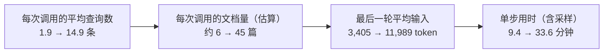

# Search-R1 复现实验报告

## 1. 项目背景与目标

本项目对 Search-R1 做了一次小规模复现，沿用其开放域问答任务和数据，用强化学习训练模型在多轮检索中判断何时继续搜索、何时作答。训练配置参考 Search-R1++，采用 fast prompt、F1+ 奖励和 REINFORCE 算法。训练循环和工具调用接口改编自 Tinker Cookbook 的 `search_tool`。[Search-R1](https://arxiv.org/html/2503.09516v4) · [Search-R1++](https://arxiv.org/html/2602.19526v1) · [Tinker Cookbook](https://github.com/thinking-machines-lab/tinker-cookbook/blob/1991897cba59ea9d9b0030d183d1867b28eba9d9/tinker_cookbook/recipes/search_tool/README.md)

实验使用一张 RTX PRO 6000 Blackwell 96GB，训练 Qwen3.5-4B 回答开放域问题。模型可以直接作答，也可以检索 Wikipedia，根据返回的文档决定下一步。每道题最多五轮；如果第五轮仍在检索，这次的检索结果就无法用于作答。

实验关注训练能否让模型更好地利用这五轮。最终选用第 75 步检查点，它在 1,894 道测试题上答对 892 道（EM 47.10%，基座模型为 32.89%），作答率为 99.21%。

后续实验主要围绕训练中出现的两种行为展开。一是在原有工具下，模型单次调用中的查询越来越多，检索结果不断占用上下文，部分题目在作答前就超出了上下文预算。二是改为每轮只执行前三条查询后，单次调用中的查询数逐渐减少，但继续训练到第 100 步，五轮用尽仍未作答的题明显增多。这两种行为都无法只从准确率看出，因此下文还统计了每轮请求和实际执行的查询数，以及每道题的终止方式（作答、五轮用尽或上下文溢出）。

各来源的完整指标、运行配置和逐题轨迹见实验归档。训练日志记录了四组正式实验的训练曲线和检查点，可按训练步数查看。[主复现实验归档](../experiments/reproduce-main/README.md) · [实验索引](experiments_zh.md) · [训练日志](https://forge.coreweave.com/wandb/timye7-personal/search-r1-reproduce?nw=sw0myi4atxa)

## 2. 实验设置与参照

### 四组正式训练

| 实验 | 全局训练步 | 本次调整 | 主要观察 |
|---|---|---|---|
| ① 原搜索规则 | 基座 → 50 | 用原有的查询列表接口训练 | 答对题数、作答率、单次调用的查询数和输入长度 |
| ② 限制每轮搜索 | 50 → 75，延长至 100 | 每轮只执行首个搜索调用中的前三条合法查询 | 请求量与执行量、上下文溢出、封顶未答、步时 |
| ③ 动态采样 | 100 → 105 | 跳过八条轨迹奖励全部相同的题组，用新题补足 64 组 | 组内奖励不同的题组比例、补充采样的成本、dev 表现 |
| ④ 加重封顶未答惩罚 | 从 75 另起分支 → 100 | 将五轮用尽且未作答的轨迹奖励从 −0.1 调至 −0.3 | 与实验②第 76–100 步的 25 次更新对比 |

下文用“原规则”和“限制搜索”分别指实验①和实验②的搜索规则。

### 训练规模与优化目标

主线每步使用 64 道题，每题采样 8 条轨迹，共 512 条轨迹，随后更新一次模型。训练到第 100 步共采样 51,200 条轨迹；另外两个分支分别进行 5 次和 25 次更新。模型关闭原生思考，采用 LoRA 训练，rank 为 32，学习率为 `4e-5`，优化器为 Adam。[主训练配置](../experiments/reproduce-main/training/stage-1/config.json) · [参数更新](../search_r1/training/update.py)

**奖励（reward）。** 对题目 $q$ 的第 $i$ 条轨迹，常规评分使用 F1+：

$$
R_{q,i}
= \max_{y\in Y_q}\operatorname{F1}(\hat y_{q,i},y)
-0.1\,\mathbf{1}[\text{未调用搜索}]
-0.1\,\mathbf{1}[\text{未给出合规答案}].
$$

其中，$Y_q$ 是参考答案集合，$\hat y_{q,i}$ 是从最后一条模型消息中提取的 `Answer:` 答案，F1 按规范化后的词级重叠计算；无法提取答案时，F1 为 0。两项扣分分别约束是否调用搜索、是否按格式作答，不对查询数量计费。因上下文超限、生成截断或解析失败而提前终止的轨迹使用固定奖励 −0.1；实验④则把封顶未答的终局奖励替换为 −0.3。[奖励实现](../search_r1/env/tools.py) · [异常终止处理](../search_r1/env/message_env.py) · [封顶未答惩罚](../search_r1/env/search_tool_env.py)

**优势与损失（loss）。** 训练采用带重要性采样的 REINFORCE。以同题八条轨迹的平均奖励为基线，每条轨迹的优势为：

$$
A_{q,i}=R_{q,i}-\frac{1}{8}\sum_{j=1}^{8}R_{q,j}.
$$

这里不再除以组内标准差，也不训练价值网络。若八条轨迹奖励相同，这组优势全部为零。同一条轨迹中，所有模型生成的 token 共用一个优势值。损失为：

$$
\mathcal L(\theta)
=-\sum_{q\in\mathcal B}\sum_{i=1}^{8}
\sum_{t\in\mathcal G_{q,i}}
\frac{\pi_\theta(a_t\mid h_t)}{\pi_{\mathrm{roll}}(a_t\mid h_t)}
A_{q,i}.
$$

$\mathcal B$ 是当前批次的题目，$\mathcal G_{q,i}$ 是轨迹中模型生成的 token 位置，$a_t$ 是该位置生成的 token，$h_t$ 包含题目、此前生成的内容和检索结果。$\pi_{\mathrm{roll}}$ 是采样时的策略。采样时，随轨迹保存每个生成 token 在该策略下的对数概率。更新时，概率比的分子是当前策略生成该 token 的概率，分母是采样策略生成同一 token 的概率。损失按生成 token 求和，提示词和工具返回内容的优势置零，不直接计入损失。正式训练不使用 PPO 裁剪或额外的 KL 惩罚。[优势与 token 掩码](../search_r1/training/data.py) · [损失调用](../search_r1/training/update.py) · [SkyRL 损失实现](https://github.com/NovaSky-AI/SkyRL/blob/79d4c8946bba23c2e0617e96ac1095c596093d83/skyrl/backends/skyrl_train/utils/ppo_utils.py)

### Rollout：多轮交互与同步采样

每轮模型生成一条消息：如果调用 `search`，工具执行查询，将结果追加到对话中，再由模型生成下一轮；如果消息不含工具调用，则结束轨迹并评分。达到五轮上限、上下文超限、生成截断或解析失败也会终止轨迹，未作答的轨迹同样参与奖励计算。

检索使用 2018 年 Wikipedia 的 BM25 索引，每条查询最多返回 3 篇文档。原规则执行调用中的全部查询；限制搜索后，每轮只执行首个搜索调用中的前三条合法查询。采样温度为 1.0，每轮最多生成 1,024 个 token，每次生成前检查输入是否超过 32,768 个 token。训练使用 fast prompt，示例直接展示工具调用和答案。

每批采样期间固定模型权重，并发生成各题的八条轨迹。全部轨迹完成后，计算奖励和组内优势，进行一次参数更新，再把新权重交给采样端生成下一批。普通采样保留全组同分的题组；动态采样分支则在同一份权重下继续换题采样，直到凑齐 64 个组内奖励不同的题组。[采样循环](../search_r1/training/loop.py) · [组内采样与补充采样](../search_r1/training/sampling.py) · [多轮环境](../search_r1/env/agent_tool_env.py) · [上下文预算检查](../search_r1/env/message_env.py)

### 参考项目的对比

Cookbook 是实现上最接近的参照：同样使用关闭原生思考的 Qwen3.5-4B、LoRA rank 32 和每题八条轨迹。主要差异及两篇论文的训练规模如下。

| 参考项目 | 训练规模 | 与本项目的主要差异 |
|---|---|---|
| Tinker Cookbook `search_tool` | 默认每步 512 题，是本项目的 8 倍；30 步验证约采样 123,000 条轨迹 | 使用向量检索和 EM 奖励，本项目使用 BM25 和 F1+ |
| Search-R1 | Qwen2.5-3B/7B，8 张 H100；PPO、GRPO 均训练 500 步 | 使用 PPO 或 GRPO，本项目使用 REINFORCE |
| Search-R1++ | Qwen2.5-3B/7B，8 张 A100，训练 600 步 | REINFORCE 每题采样 5 条轨迹，并使用 KL 正则；本项目每题 8 条，不加 KL 惩罚 |

[Cookbook 训练配置](https://github.com/thinking-machines-lab/tinker-cookbook/blob/1991897cba59ea9d9b0030d183d1867b28eba9d9/tinker_cookbook/recipes/search_tool/train.py) · [Search-R1 实验设置](https://arxiv.org/html/2503.09516v4) · [Search-R1++ 实验设置](https://arxiv.org/html/2602.19526v1)

Cookbook 的 EM 奖励按答案是否完全匹配给分，并对答案格式不合规扣分；本项目的 F1+ 对部分匹配也给分，另对未调用搜索扣分。因此，两者训练奖励只能粗略对照：Cookbook 的 30 步验证从 0.39 升至 0.60，本项目第 1 步和第 30 步分别为 0.46、0.56，第 26–30 步平均为 0.59。本文的训练收益均在本项目固定评测集上比较；fast prompt、F1+ 和 REINFORCE 同时采用，未分别检验各自的贡献。[Cookbook 结果说明](https://github.com/thinking-machines-lab/tinker-cookbook/blob/1991897cba59ea9d9b0030d183d1867b28eba9d9/tinker_cookbook/recipes/search_tool/README.md) · [本项目逐步指标](../experiments/reproduce-main/training/stage-1/metrics.jsonl)

### 数据与评测指标

训练题来自 Natural Questions（NQ）和 HotpotQA。固定开发集（dev，631 题）和测试集（test，1,894 题）题目互不重叠，覆盖这两个来源及另外五个来源。总体指标按题汇总。EM 是规范化后与任一参考答案完全匹配的比例，F1 衡量词级重叠，作答率是评分器能从输出中提取到合规 `Answer:` 答案的题目比例。“封顶未答”指因达到五轮上限而终止、且评分器未提取到有效答案的题。“作答时 EM”只统计给出答案的题，不同评测中作答的题可能不同，因此比较训练收益时，还会把同一道题在两个检查点上的结果配对比较。行为指标区分每题调用搜索的次数、模型在调用中请求的查询条数，以及工具实际执行的查询条数。[固定评测集](../eval_sets/) · [抽样脚本](../scripts/make_eval_sets.py) · [评测实现](../search_r1/offline_eval.py)

## 3. 本地基座选型与云端验证

本地选型使用 oMLX，在同一批 631 道 dev 题上比较两种模型和两种 prompt。原版 prompt 来自 Cookbook；fast prompt 去掉了逐步思考的要求，示例中直接给出工具调用和答案。

| 本地模型与设置 | EM | 作答率 | 五轮上限终止（题） | 搜索调用/题 | 生成 token/题 |
|---|---:|---:|---:|---:|---:|
| Qwen3-4B-Instruct-2507，原版 | 23.93% | 91.13% | 3 | 0.96 | 156 |
| Qwen3-4B-Instruct-2507，fast | 20.44% | 83.04% | 0 | 0.88 | 79 |
| Qwen3.5-4B，关思考，原版 | 32.65% | 53.72% | 275 | 3.35 | 327 |
| **Qwen3.5-4B，关思考，fast** | **33.28%** | **60.38%** | **242** | **3.01** | **256** |
| Qwen3.5-4B，开思考，fast | 37.24% | 63.87% | 226 | 2.96 | 591 |

使用 fast prompt 时，Qwen3-4B-Instruct-2507（下文简称 Qwen3-Instruct）在 631 题中只有 38 题调用了两次及以上搜索；Qwen3.5 有 435 题，同时有 242 题用尽了五轮。Qwen3.5 已经会根据中间结果继续检索。选用它，可以进一步观察训练能否让模型更好地判断何时该结束检索、给出答案。开启原生思考多答对 25 题，但生成量是关闭思考时的 2.31 倍。考虑到单卡预算，正式实验选用关闭思考的 Qwen3.5-4B 和 fast prompt。本地分数只用于选型，正式结果均来自云端评测，下文的“基座模型”也指云端评测结果。[五组本地评测与轨迹](../experiments/local-baselines/README.md)

正式训练前，先在 A100 80GB 上验证了工具调用和参数更新。重启后，又验证了能否加载完整检查点进行评测，以及能否恢复优化器状态继续训练。正式训练和评测的后端为自部署的 SkyRL，通过 Tinker SDK 调用。[云端验证](../experiments/cloud-validation/README.md) · [正式环境](../experiments/formal-environment.txt)

## 4. 原规则下的前 50 步

### 准确率提高的两个阶段

在 test 上，基座模型、第 25 步和第 50 步分别答对 623、852、912 题。下表按来源和题目 ID 对齐三个检查点的评测结果，把净增的答对数分成两部分：两个检查点都作答的题，以及只有一个检查点作答的题。

| 同题比较（test） | 净多答对 | 两次都作答的题贡献 | 仅一次作答的题贡献 |
|---|---:|---:|---:|
| 基座 → 第 25 步 | +229 | +21 | +208 |
| 第 25 → 50 步 | +60 | +78 | −18 |

前 25 步的提升主要来自作答率上升，作答率从 59.93% 升至 97.78%。从第 25 步到第 50 步，两次都作答的 1,657 题净多答对 78 题，但作答率回落至 88.97%。总体 EM 上升的同时未作答的题增多，因此接下来逐轮检查了搜索轨迹。[原规则 test 汇总与逐题轨迹](../experiments/reproduce-main/evaluations/original-search/test/)

### 第 50 步的工具规则调整

原工具允许一次 `search` 调用提交一个查询列表，BM25 为每条查询返回最多三篇文档，依次加入上下文。多写一条查询就多一次检索到答案的机会，而训练奖励不计查询成本。下图比较训练第 1 步和第 45 步，文档量按每条查询返回三篇估算，可能包含重复文档。

输入增长主要来自检索结果。以第 36 步为例，每条轨迹最后一轮平均输入 9,290 个 token，其中估计有 8,881 个来自提示和检索内容。第 46–50 步平均每步用时 37.1 分钟；第 50 步 test 中有 **160/1,894 题（8.45%）**因上下文溢出而终止。[训练指标](../experiments/reproduce-main/training/stage-1/metrics.jsonl) · [第 50 步 test 终止原因](../experiments/reproduce-main/evaluations/original-search/test/step-0050/summary.json)

每轮执行的查询数上限定为三条，依据是对第 50 步 dev 轨迹的回放：取原本答对的 308 题，在已有轨迹中每次成功调用只保留前 1、3、5 条查询的文档，文档中包含标准答案或其别名的分别有 230、273、286 题。从一条放宽到三条多覆盖 43 题，再放宽到五条多覆盖 13 题。回放只衡量答案文本是否出现在文档中；回放中的后续查询仍是模型看过完整文档后写出的，限制搜索后模型未必会这样查询。限制搜索后的实际准确率见下一节的重新采样结果。[用于回放的第 50 步 dev 轨迹](../experiments/reproduce-main/evaluations/original-search/dev/step-0050/trajectories.jsonl)

从第 50 步的完整状态续训时，每轮只执行**首个搜索调用中的前三条合法查询**，每轮最多返回九个文档条目，模型可以在下一轮根据新结果继续检索。当时考虑过的其他方案包括在工具返回中提示“只执行了前三条”，或在任务 prompt 中写明查询数限制和五轮上限。为了尽量保持原有交互环境，最终没有加入提示，工具只返回实际执行的结果，同时删去工具说明中“每条查询都会返回结果”的表述。这样可以观察在没有额外提示的情况下，模型仅根据返回结果和原有奖励会如何调整行为。[限制搜索的环境实现](../search_r1/env/search_tool_env.py)

## 5. 限制搜索后的适应与延长训练

下表前两行比较第 50 步模型在两种搜索规则下的 dev 表现。后两行给出限制搜索后继续训练到第 75 步和第 100 步的结果。

| dev，631 题 | EM | 作答率 | 上下文溢出（题） | 封顶未答（题） |
|---|---:|---:|---:|---:|
| 第 50 步，原规则 | 48.81% | 89.70% | 51 | 9 |
| 第 50 步，限制搜索 | 45.01% | 80.67% | 0 | 116 |
| 第 75 步，限制搜索 | 47.39% | 98.89% | 0 | 5 |
| 第 100 步，限制搜索 | 47.07% | 87.80% | 0 | 69 |

**切换规则时**，上下文溢出从 51 题降到 0，封顶未答从 9 题增至 116 题（18.4%）。在新规则下，第 50 步模型首轮请求的查询数中位数仍为 16 条，但只有前三条会被执行。第 25 步检查点也做了固定权重重评，切换规则后 dev EM 从 44.37% 降至 41.52%。[原规则第 50 步 dev](../experiments/reproduce-main/evaluations/original-search/dev/step-0050/) · [限制搜索后的 dev 复评](../experiments/reproduce-main/evaluations/limited-search/dev/)

**继续训练到第 75 步**，封顶未答降至 5 题，比同一规则下的第 50 步净多答对 15 题。第 51–55 步平均每步用时 11.4 分钟，第 71–75 步为 9.3 分钟，而原规则下第 46–50 步为 37.1 分钟。[第 51–75 步训练指标](../experiments/reproduce-main/training/stage-2/metrics.jsonl)

**延长到第 100 步**，单次调用中的查询数减少，搜索调用次数增加：test 首轮请求的查询数中位数从 10 条降至 5 条，每题平均搜索调用从 2.20 次增至 2.91 次，封顶未答从 **8 题增至 234 题**。第 75 步是在 dev 和 test 都评测完成后选定的。两个检查点在 dev 上的答对数仅相差 2 题（299 对 297），第 75 步的 dev 作答率高出 11.09 个百分点。[检查点选用记录](../experiments/reproduce-main/README.md) · [限制搜索的 test 评测](../experiments/reproduce-main/evaluations/limited-search/test/)

### 全组同分的题组增多

同一道题的八条轨迹如果奖励全部相同，减去组内均值后，八条轨迹的优势都为零。第 51–75 步平均每步有 37.7/64 组（58.9%）全部同分，第 76–100 步升至 43.3/64 组（67.6%）。下一个实验检验：如果每次更新都有足够多组内奖励不同的题组，现有奖励能否改善作答。[第二阶段训练记录](../experiments/reproduce-main/training/) · [组内优势计算](../search_r1/training/data.py)

现有奖励已经对封顶未答的轨迹给出 −0.1，因此这一步只改采样方式，奖励、工具和 prompt 保持不变。如果同时加重惩罚，或在 prompt 中提醒“最后一轮请作答”，即使作答率回升，也难以判断其中有多少来自有效题组的增加。

## 6. 两个后续实验

### 从第 100 步开始动态采样

每次更新前固定当前策略，跳过八条轨迹奖励全部相同的题组，换新题补充采样，直到凑齐 64 个组内奖励不同的题组（下称有效组）。有效组比例以所有尝试过的题组为分母，最后一轮多采出的有效组也计入。

| 已完成更新 | 为凑齐 64 组尝试的题数 | 有效组比例 | 单步用时 |
|---:|---:|---:|---:|
| 101 | 158 | 41.1% | 21.8 分钟 |
| 102 | 187 | 34.8% | 23.1 分钟 |
| 103 | 192 | 33.9% | 23.7 分钟 |
| 104 | 202 | 32.7% | 26.3 分钟 |
| 105 | 241 | 29.9% | 27.8 分钟 |

每步都凑齐了 64 个有效组，但五步内有效组比例持续下降，凑齐一批所需尝试的题数从 158 道增至 241 道，单步用时从 21.8 分钟增至 27.8 分钟。这一分支在第 105 步停止，只评测了 dev。与第 100 步相比，封顶未答从 69 题降至 56 题，仍多于第 75 步的 5 题。[动态采样配置和逐步指标](../experiments/dynamic-sampling/training/) · [第 105 步 dev](../experiments/dynamic-sampling/evaluations/limited-search/dev/step-0105/)

dev 答对数从 297 增至 301（EM 47.07% → 47.70%，F1 56.53% → 57.00%）。两次都作答的 530 题中，两个检查点各答对 288 题；只有第 105 步作答的题中答对 13 题，只有第 100 步作答的题中答对 9 题，因此净增的 4 题全部来自只有一方作答的题。按全部 631 题配对，32 题由错变对，28 题由对变错，EM 差为 +0.63 个百分点，配对差值的近似 95% 区间为 −1.77 至 +3.04 个百分点，包含 0。仅凭这一次评测，还不能确认这是稳定的收益。[第 100 步 dev 轨迹](../experiments/reproduce-main/evaluations/limited-search/dev/step-0100/trajectories.jsonl) · [第 105 步 dev 轨迹](../experiments/dynamic-sampling/evaluations/limited-search/dev/step-0105/trajectories.jsonl)

### 从第 75 步分支，加重封顶未答惩罚

该分支恢复第 75 步的模型和优化器状态，按与主线相同的题序和普通采样方式再训练 25 步，因此可以直接与主线第 76–100 步比较。唯一的改动是把五轮用尽且没有有效答案的轨迹奖励设为 −0.3；第五轮给出有效答案的轨迹按常规评分。两条分支的 dev 和 test 评测使用相同的评分方式。[惩罚分支配置与评测](../experiments/max-turns-penalty/README.md)

第 100 步时，主线在 dev 上答对 297 题，惩罚分支答对 286 题，少答对 11 题。在 test 上，主线答对 876 题，惩罚分支答对 849 题，少答对 27 题。加重惩罚原本是为了减少封顶未答，但在 test 上，主线有 234 题封顶未答，惩罚分支有 319 题。首轮请求的查询数中位数，主线为 5 条，惩罚分支为 30 条。在两者都作答的 1,479 道 test 题中，主线答对 829 题，惩罚分支答对 828 题。其余 26 题的差距来自只有一方作答的题。[原第 100 步 test 轨迹](../experiments/reproduce-main/evaluations/limited-search/test/step-0100/trajectories.jsonl) · [惩罚分支 test 轨迹](../experiments/max-turns-penalty/evaluations/limited-search/test/step-0100/trajectories.jsonl)

为了估计新惩罚改变了多少训练信号，在该分支采到的 12,800 条轨迹上，把触发惩罚的轨迹奖励还原为 −0.1，再按组重新计算优势并与原值比较。共有 159 条轨迹触发了新增惩罚，其中 149 条出现在最后五步；组内优势发生变化的只有 **51/1,600 个题组（3.2%）**。这 159 条中，135 条原本就是负优势，加重惩罚后优势进一步降低。另外 24 条轨迹来自三个题组，每组的八条轨迹都封顶未答。由于同组轨迹的奖励都降低了相同的幅度，减去新的组均值后，每条轨迹的优势仍为零。[惩罚分支训练指标](../experiments/max-turns-penalty/training/metrics.jsonl) · [奖励触发条件](../search_r1/env/search_tool_env.py)

新增惩罚只在五轮用尽且未给出有效答案时触发，不直接约束查询数量。

## 7. 主结果与讨论

下表为正式 test（1,894 题）上的结果。“搜索调用/题”是每题尝试调用工具的平均次数；“作答时 EM”只统计各行给出有效答案的题，各行分母不同。

| 检查点 | 答对数 | EM | F1 | 作答率 | 作答时 EM | 搜索调用/题 | 封顶未答（题） | 上下文溢出（题） |
|---|---:|---:|---:|---:|---:|---:|---:|---:|
| 基座模型[^base] | 623 | 32.89% | 39.59% | 59.93% | 54.89% | 3.04 | 714 | 0 |
| 原规则 25 | 852 | 44.98% | 53.81% | 97.78% | 46.00% | 1.62 | 11 | 0 |
| 原规则 50 | 912 | 48.15% | 57.03% | 88.97% | 54.12% | 2.20 | 29 | 160 |
| **限制搜索 75（选用）** | **892** | **47.10%** | **55.99%** | **99.21%** | **47.47%** | **2.20** | **8** | **0** |
| 限制搜索 100 | 876 | 46.25% | 55.37% | 86.43% | 53.51% | 2.91 | 234 | 0 |
| 限制搜索 100，加重惩罚 | 849 | 44.83% | 53.09% | 83.05% | 53.97% | 3.24 | 319 | 0 |

[^base]: 基座模型只在原规则下评测过；限制搜索规则下最早评测的检查点是第 25 步（dev）。

每个检查点在每种评测设置下对每题只采一条轨迹。按 dev 的 631 道题估算，单个检查点总体 EM 的标准误约为 2 个百分点。

test EM 最高的是原规则第 50 步。它与选用的第 75 步平均每题都调用 2.20 次搜索，但单次调用能返回的文档量相差很大：在同一份 test 上，第 50 步原规则评测的采样用时 40.2 分钟，第 75 步限制搜索评测用时 15.7 分钟。这两个检查点既相差 25 次参数更新，使用的搜索规则也不同；要区分两者各自的影响，需要参照第 5 节的固定权重 dev 对照。[原规则 test](../experiments/reproduce-main/evaluations/original-search/test/) · [限制搜索 test](../experiments/reproduce-main/evaluations/limited-search/test/)

### 两个案例

**根据中间结果再次检索。** 2WikiMultihopQA 的 `dev_8136` 问 Casimir I of Kuyavia 的父亲何时去世。在使用 fast prompt 的本地评测中，两个基座模型第一轮都检索到其父亲是 Konrad I of Masovia。文档中没有死亡日期，Qwen3-Instruct 直接回答 `Unknown`；Qwen3.5 用这个名字在第二轮查询 `Konrad I of Masovia death date`，返回的文档给出 1247 年 8 月 31 日，第三轮答对。[Qwen3-Instruct 轨迹](../experiments/local-baselines/evaluations/base-q3i-fast-n100/trajectories.jsonl) · [Qwen3.5 轨迹](../experiments/local-baselines/evaluations/base-q35-fast-n100/trajectories.jsonl)

**五轮用尽仍未作答。** test 中 MuSiQue 的 `dev_560`（ID 沿用源数据）问：回忆录 *One More Time* 作者的哪个孩子参与了舞台剧改编。第 75 步模型第一轮没有找到这部作品，第二轮执行的查询中有 `One More Time book`，返回的条目写明 Carol Burnett 和女儿 Carrie Hamilton 合写了 *Hollywood Arms*，模型在第三轮答出 Carrie Hamilton。第 100 步模型首轮只请求了 5 条查询，之后的查询转向 Elizabeth Gilbert、T. J. Clark、John Steinbeck 等方向，五轮全部用于搜索，没有作答。[第 75 步轨迹](../experiments/reproduce-main/evaluations/limited-search/test/step-0075/trajectories.jsonl) · [第 100 步轨迹](../experiments/reproduce-main/evaluations/limited-search/test/step-0100/trajectories.jsonl)

### 小结

- 原规则下，前 25 步的提升主要来自作答率上升；从第 25 步到第 50 步，两次都作答的题净多答对 78 题，同时作答率回落。
- 原规则下的上下文溢出与单次调用中查询数的增长有关，只看每题搜索调用次数反映不出这一点。固定第 50 步权重切换到限制搜索后，dev EM 从 48.81% 降至 45.01%，封顶未答从 9 题增至 116 题；在新规则下训练到第 75 步，封顶未答降至 5 题。
- 继续训练到第 100 步，封顶未答再次增多。动态采样分支第 105 步的 dev 答对数比第 100 步多 4 题，配对区间包含 0，封顶未答为 56 题，仍多于第 75 步的 5 题。加重惩罚的分支在 test 上少答对 27 题，封顶未答从 234 题增至 319 题；新增惩罚只改变了 3.2% 题组的组内优势。

## 附录　按来源结果与复现资料

下表为基座模型和两个代表性检查点在各来源上的 test EM。NQ 和 HotpotQA 是训练题的来源，其余五个来源用于观察跨来源表现。Bamboogle 只有 94 道 test 题，每题约占 1.06 个百分点。

| 来源 | test 题数 | 基座模型 | 原规则 50 | 限制搜索 75 |
|---|---:|---:|---:|---:|
| NQ | 300 | 27.00% | 38.33% | 36.67% |
| HotpotQA | 300 | 37.00% | 51.00% | 51.00% |
| TriviaQA | 300 | 53.67% | 68.67% | 67.67% |
| PopQA | 300 | 32.67% | 48.33% | 43.67% |
| 2WikiMultihopQA | 300 | 36.00% | 54.67% | 62.67% |
| MuSiQue | 300 | 10.00% | 25.00% | 19.67% |
| Bamboogle | 94 | 36.17% | 57.45% | 51.06% |

在 A100 预实验中，服务端裁剪 microbatch 左侧的公共 padding 后，以 microbatch 1 完成了三次更新和一次重启续训。同一批 271 道题在并发 32 和 64 下评测分别用时约 84 秒和 87 秒，正式评测使用并发 32。正式环境以 8,000 token 的序列长度为阈值切换梯度检查点，每五步保存一次训练状态，分支实验从父检查点恢复模型和优化器状态。[验证与计时](../experiments/cloud-validation/README.md) · [正式环境与软件版本](../experiments/formal-environment.txt) · [部署及恢复脚本说明](../scripts/README.md)
